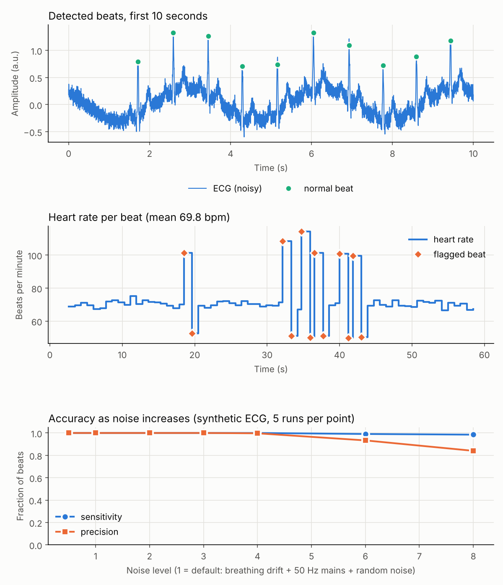

# ECG heart-rate monitor with irregular-beat flags

Finds heartbeats in a noisy ECG signal, works out the heart rate, and flags beats that arrive too early or after a long pause. Written in Python with numpy and scipy.

> **Learning project, not a medical device.** It looks at beat timing only and cannot diagnose anything.



## How it works

1. **Band-pass filter (5 to 15 Hz).** Keeps the sharp QRS spike of each beat and removes slow breathing drift and most noise. The filter runs forwards and backwards, so the beats do not shift in time.
2. **Differentiate, square, smooth.** Turns each QRS spike into one clear hump, a simplified version of the classic Pan-Tompkins method.
3. **Adaptive threshold.** Learns the typical signal and noise levels as it goes, with a 200 ms refractory period so one beat is not counted twice.
4. **Heart rate and flags.** Heart rate is 60 divided by the time between beats. A beat is flagged *premature* if its interval is under 80 % of the recent median, and as a *pause* if it is over 120 %.

## Results

There is no real patient data in this repo, so the tests use a **synthetic ECG generator** (`synth_ecg`) that places beats at known times. It adds breathing drift, 50 Hz mains interference and random noise, and inserts premature beats. Because the true beat positions are known, accuracy can be measured exactly.

| Check | Result |
|---|---|
| Default noise, 60 s demo | 67 of 67 beats found, 0 extra, mean 69.8 bpm |
| Heart rate error (5 seeds) | under 2 bpm |
| Premature beats flagged (15 % rate, 5 seeds) | at least 90 % found, at most 2 false flags |
| Noise sweep | sensitivity stays near 1.0 at every level; precision starts dropping above noise level 4 (about 0.85 at level 8) |

Premature beats in the generator are followed by a pause, as in real ectopic beats, so flagged *premature* and *pause* counts come in pairs.

## Run it

```bash
pip install -r requirements.txt
python ecg_monitor.py                        # synthetic demo, saves results/ecg_demo.png
python ecg_monitor.py --csv ecg.csv --fs 360 # a text file with one sample per line
python ecg_monitor.py --wfdb data/100        # a local MIT-BIH record (needs wfdb)
python -m pytest -q                          # 6 tests
```

To try real data, download a record such as `100` (the `.dat`, `.hea` and `.atr` files) from the [MIT-BIH Arrhythmia Database on PhysioNet](https://physionet.org/content/mitdb/) into a `data/` folder. With `--wfdb`, the program also compares its detections against the annotated beats and prints sensitivity and precision. Output for your own data goes to `results/ecg_custom.png`.

## Limitations

- **The accuracy figures above are on synthetic data** made by this repo's own generator, so they are optimistic. Real ECGs have baseline jumps, varied beat shapes and electrode noise that this does not reproduce.
- The `--wfdb` and `--csv` loaders were checked only on a generated file in the same format. The tool has not been run on real MIT-BIH recordings yet.
- No search-back for missed beats and no T-wave rejection (marked as a `shortcut:` in the code).
- Flags use interval timing only. They are not clinical beat classifications.

## Next steps

- Run on several MIT-BIH records and report sensitivity and precision per record.
- Add search-back for missed beats and use QRS width to tell premature beats from normal ones.
